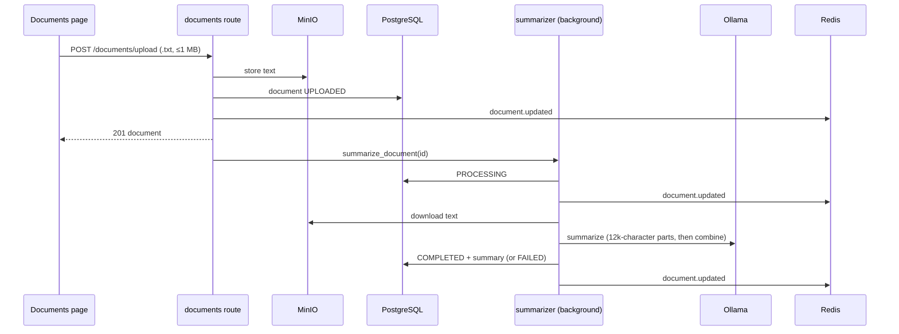
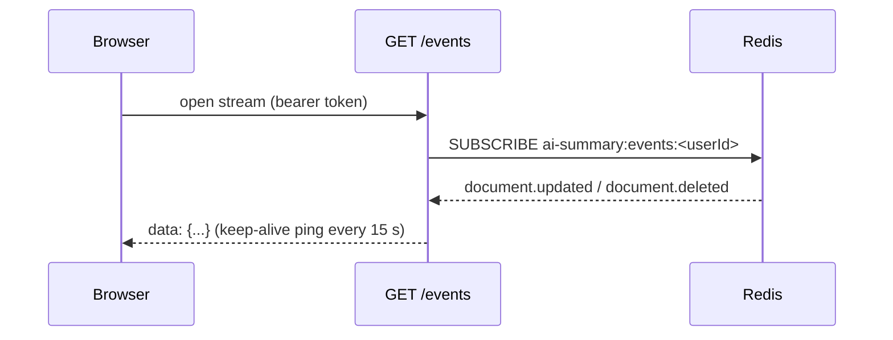

# AI summary API — flows

## Upload to summary

## Live updates

## Restarts and failures

- Documents left UPLOADED or PROCESSING are resumed at startup.
- A failed summary keeps status FAILED and logs the cause (Ollama's own message); `POST /documents/{id}/summarize` retries it.
