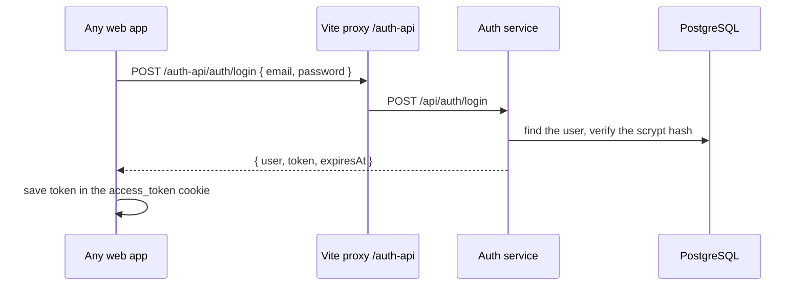
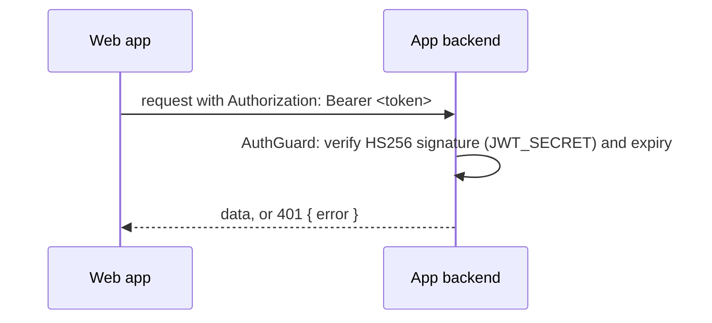

# Auth service — flows

## Sign-in

Register is the same call on `/auth/register`, after checking that the email and name are free.

## Calling another API

## Restoring and ending a session

1. On load, `AuthGate` reads the `access_token` cookie and calls `GET /api/auth/me`; a 401 (expired token or deleted account) clears the cookie and shows `LoginScreen`.
2. A 401 from any app's API (`createAppApiClient`) signs out the same way, so an expired token leads back to the login screen.
3. Sign-out deletes the cookie; there is no server-side session to end, the token simply expires.
4. Deleting the account (`DELETE /api/account` with the password) removes the user and the photo, then signs out.
