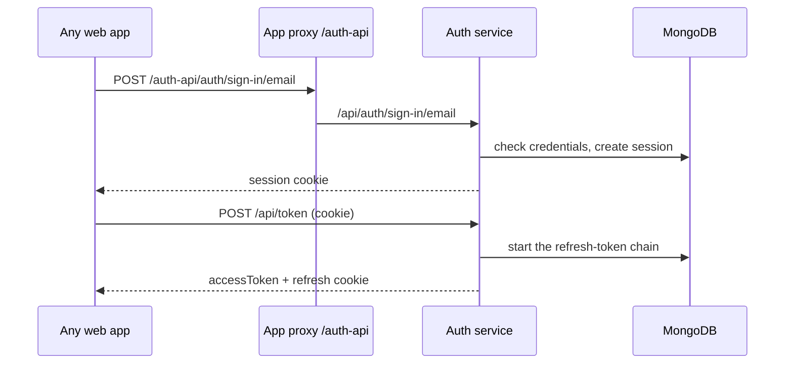
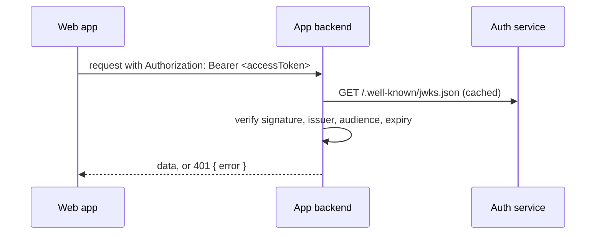

# Auth service — flows

## Sign-in and first token

## Calling another API

## Renewal and sign-out

1. Before the access token expires the client calls `POST /api/token`; the refresh cookie is rotated (a just-replaced token stays valid briefly for parallel tabs).
2. A missing or reused refresh token ends the session and clears both cookies (401).
3. `POST /api/logout` deletes the refresh token and the session and clears the cookies.
