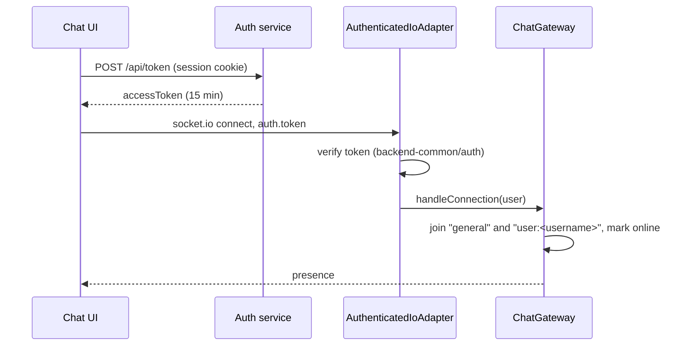
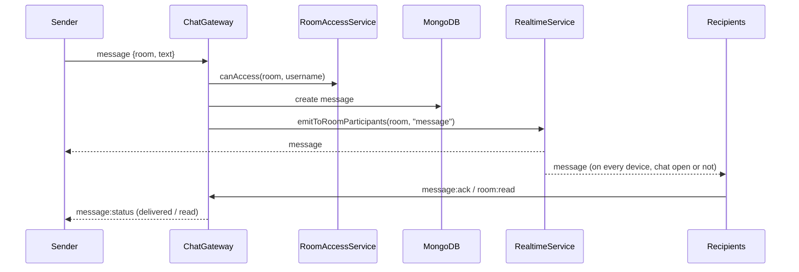
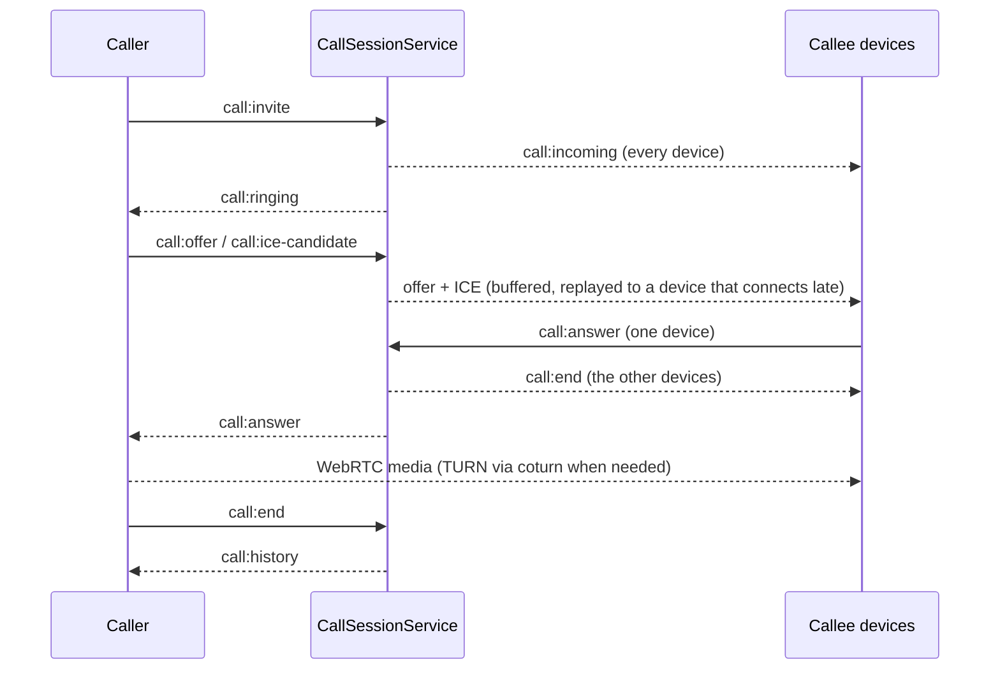

# Chat API — flows

## Connecting

The client's `auth` callback fetches a fresh token on every reconnect.

## Sending a message

Push notifications are sent with `void`, so a push failure never blocks delivery.

## Files and history

1. The UI uploads with `POST /rooms/:room/files` (multer limits from `createUploadOptions`).
2. The service checks room access, stores the bytes in MinIO and the metadata in `sharedfiles`, creates a message and fans it out like a text message.
3. History is `GET /rooms/:room/messages`; deleted messages stay as `deleted: true` with blank text so receipts and "message deleted" still render.

## 1:1 calls

Group calls use `group-call:*` events; signaling reaches all of a user's devices and only the one in the call acts on it.
