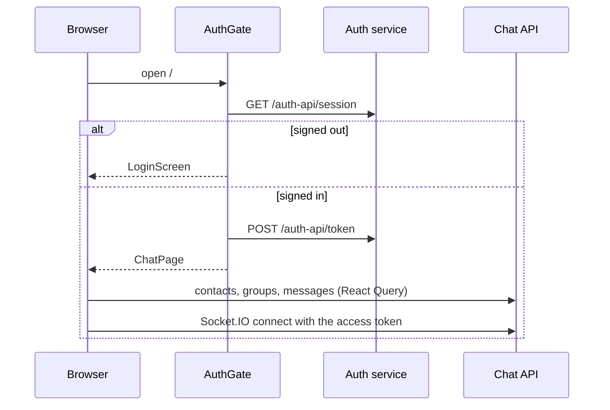

# Chat UI — flows

## Startup

## Sending and receiving

1. `MessageInput` emits `message {room, text}` (or uploads a file with `POST /rooms/:room/files`).
2. The server fans the stored message out to every participant's `user:` room; `useSocket` appends it to the store, updates the conversation preview and the unread count.
3. Opening a chat emits `room:join` and `room:read`; the sender sees ticks change through `message:status`.

## Token renewal

- `apiClient` and the socket ask `authClient.getAccessToken()`, which renews the 15-minute token before it expires.
- A 401 calls `authClient.refresh()`; a revoked session signs the user out everywhere.

## Calls

1. Starting a call emits `call:invite`; the callee's devices show the incoming-call alert.
2. Offer, answer and ICE candidates travel over the socket; media flows peer to peer (or through coturn).
3. Hanging up emits `call:end`; the call log refreshes from `call:history`.
