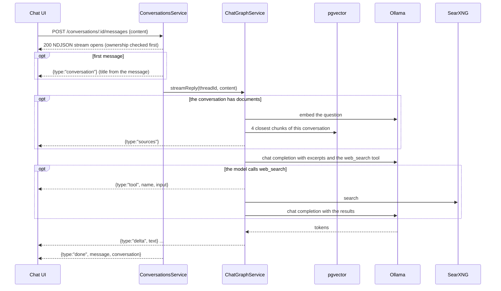

# Chatbot API — flows

## Sending a message

## Uploading a document

1. Ownership of the conversation is checked, then the type (`.txt`, `.md`, `.pdf`) and the size.
2. Text is extracted; an empty result is a `400` (scanned PDFs have no text layer).
3. The file goes to S3, the text is split and embedded into `document_chunks`, and the `documents` row is saved with the chunk count.

## Stop and disconnects

- The reply keeps generating if the browser leaves, so it is always saved.
- Stop closes the request; the service aborts the graph and saves the partial reply (with its sources) as the assistant message. A turn stopped during a tool call leaves its tool steps in the thread; later turns skip them.

## Failures

- Model errors arrive as `{type:"error"}` with Ollama's message; "signal: killed" means Ollama ran out of memory in Docker.
- A failed web search is logged with the upstream status and body and handed to the model as text.
