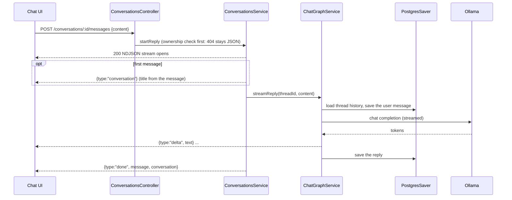

# Chatbot API — flows

## Sending a message

## Stop and disconnects

- The reply keeps generating if the browser leaves, so it is always saved.
- Stop closes the request; Nest destroys the stream, the service aborts the graph and saves the partial reply as the assistant message.

## Failures

- Model errors arrive as `{type:"error"}` with Ollama's message; "signal: killed" means Ollama ran out of memory in Docker.
