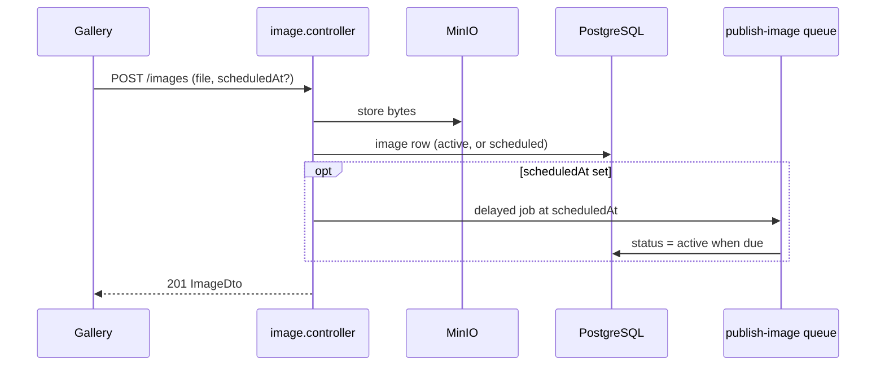

# Image upload API — flows

## Upload (now or scheduled)

## Bin

1. `DELETE /images/:id` sets `deletedAt`; the image moves to the bin.
2. `POST /images/:id/restore` clears it; `DELETE /images/:id/permanent` removes the row and the MinIO object.
3. The `purge-bin` job deletes everything binned longer than the retention period.
