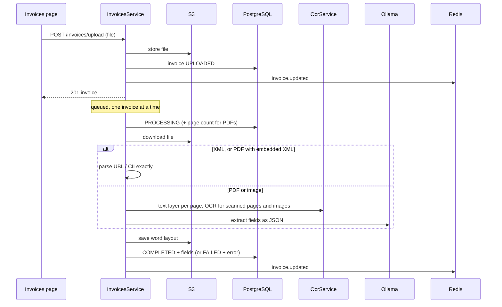

# Invoice API — flows

## Upload to fields

## Correcting an invoice

1. The user edits fields; the frontend calls `POST /invoices/:id/edit-plan` with the unsaved values (debounced) and draws the placements over the page images.
2. `planEdits` looks up each changed field's old value (from `extracted_fields`) among the saved word positions, and plans a cover rectangle in the paper colour plus the new text in the matching standard font, size and colour. Values it cannot find are listed in `unplaced`.
3. `PATCH /invoices/:id` saves the values; `GET /invoices/:id/pdf` (or `POST` with unsaved changes) draws the plan onto the original with pdf-lib. PNG and JPEG are wrapped in a PDF page first; XML and TIFF get a generated invoice instead.

## Builder invoices

1. `POST /invoices/compose` renders the blocks as a one-page A4 PDF (`renderComposedPdf`) and stores it like an upload.
2. Its fields are known from `data`, so extraction only reads the word layout (for later corrections) and skips the model.

## Restarts

- Invoices left `UPLOADED` or `PROCESSING` are queued again when the service starts.
