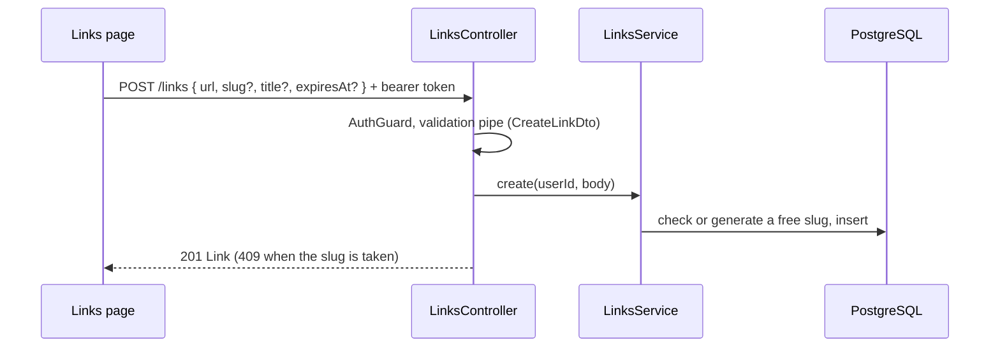
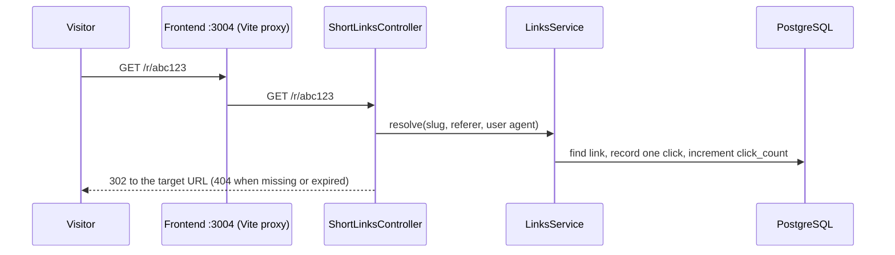

# Link shortener API — flows

## Creating a link

## Following a short link

## Stats

- `GET /links/:id/stats` counts the link's clicks per day for the last 30 days, filling days without clicks with `0`; the frontend shows them in a chart dialog.
