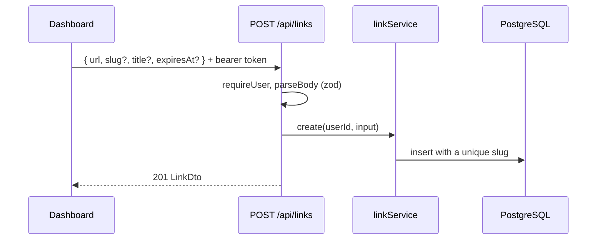
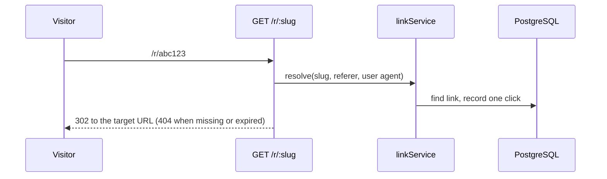

# Link shortener — flows

## Creating a link

## Following a short link

## Stats

- `GET /api/links/:id/stats` returns clicks per day for the last 30 days; the dashboard shows them in a chart dialog.
